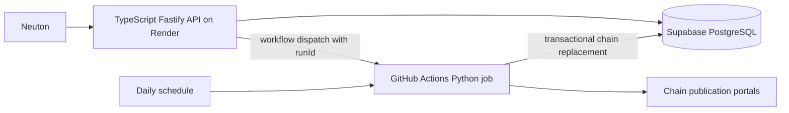

# Specification: supermarket ingestion service

Status: implementation-ready design for review; no implementation is included. Date: 2026-10-30.
Companion: [Search API specification](SPEC-supermarket-api.md). Read both before implementation. This document owns ingestion, shared SQL schema, refresh coordination, and publication semantics. The companion owns HTTP contracts and matching. Plans are embedded in these two documents at the user's request.

## 1. Purpose and customers

Neuton businesses need estimated ingredient and recipe costs when their own purchasing data is unavailable. Existing search covers Shufersal and Carrefour. Expand to ten chains without paid price APIs, keeping only current product averages. These are sampled retail estimates, not actual business acquisition costs, nationwide chain prices, availability promises, or promotion-aware offers.

Launch consumer: Neuton's backend only. Operators use protected refresh/status endpoints. Future consumers may be external app developers with API keys and agents through MCP and x402 payments. Design clean boundaries for that future; do not implement customer accounts, billing, wallets, MCP, or x402 in this release.

## 2. Agreed scope

Chain IDs are stable public identifiers:

| ID | Chain |
|---|---|
| shufersal | Shufersal |
| carrefour | Carrefour |
| rami-levy | Rami Levy |
| yochananof | Yochananof |
| osher-ad | Osher Ad |
| victory | Victory |
| mahsanei-hashuk | Mahsanei HaShuk |
| hatzi-hinam | Hatzi Hinam |
| tiv-taam | Tiv Taam |
| keshet-teamim | Keshet Teamim |

Every daily run randomly selects three distinct branches per chain anew. Use latest available PriceFull files only. No deltas, promotions, price history, raw-file retention, or branch-price persistence. Store one current row per product per chain, with its sampled arithmetic mean in `item_price`. Re-randomization may change an estimate without any underlying branch price change.

Operational deferral (user decision, 2026-10-30): retain all ten public IDs, but
defer Carrefour and Shufersal source recovery. Default collection currently uses
the other eight chains. Deferred sources must not be reported as refreshed or
erase existing catalogs. Track recovery in `tasks/deferred.md`; this does not
change sampling, averaging or retention rules for active chains.

## 3. Topology and technologies



One future standalone repository, two deployable components: `services/api` and `services/ingestor`, plus `db/migrations`, `contracts`, and `.github/workflows`. Do not add the implementation to Neuton-Back by default. Its existing code is a reference and later integration target.

Python 3.12 baseline; pytest, Ruff, Psycopg 3, standard-library Decimal, and an XML parser configured to prohibit external entities. Lock exact dependency versions during bootstrap. Trial `israeli-prices` first for branch listing and full-file retrieval; use OpenIsraeliSupermarkets `il-supermarket-scraper` plus its parser if the trial fails. Do not claim a provider is supported until tested. Keep a provider adapter boundary independent of both libraries.

GitHub Actions runs the collection itself, not a long HTTP request to Render. Render hosts the search/control API. Supabase hosts shared PostgreSQL state. GitHub permissions are restricted to the repository/workflow required. No Redis, object storage, or permanent worker is required initially.

Cost constraints: zero recurring spend. Verify Actions allowance/runtime, Supabase database/egress limits, and Render allowance. Render native cron is paid and must not be silently introduced. Geo-blocked chains may remain unavailable; never purchase a proxy automatically. Pilot from the actual hosted runner, not only an Israeli development machine.

## 4. Explicit engineering defaults

These complete previously unspecified details; they are design defaults, not additional user promises:

- Source timestamp older than 48 hours is stale. Keep searchable data regardless of age, with accurate freshness. A successful old-file ingestion is not labeled fresh.
- Branch eligibility: a physical grocery branch with a discoverable full catalog. Exclude identifiable pharmacy-only and online-only subchains; do not apply the earlier proposed geographic stratification or express-format exclusion. Uniform random sampling over eligible branches.
- Three branch slots, each at most three distinct branch attempts: initial plus two replacements. At most nine application-level branch attempts per chain. Do not hide unbounded retries inside adapters.
- A structurally valid nonempty catalog is required for branch success. An empty/malformed catalog is an attempt failure. Invalid individual rows are skipped and counted; zero valid rows makes the branch fail.
- Runtime budget 45 minutes per job; source HTTP timeout 60 seconds, explicit streaming byte limit 100 MB decompressed per branch, low concurrency initially (one branch at a time). Make these configurable and adjust from measured fixtures, never truncate and publish a partial branch silently.

## 5. Collection and replacement algorithm

1. Establish a run and reserve its chain set as described below. Load chain configuration and provider mappings.
2. List branches and full-price files. Parse branch identity from source metadata; use `(chain, subchain, store)` internally, never store number alone. Randomly shuffle eligible distinct branches once per chain/run; retain selected IDs in operational metadata for diagnosis, not branch prices.
3. For each of three slots, attempt the next unattempted branch. Download its latest complete PriceFull; parse and validate entirely before counting success. If it fails, use up to two replacement branches. Never retry an already attempted branch in another slot, or count a successful branch twice. If candidates are exhausted, stop attempting that slot. A chain with fewer than three eligible branches uses those available.
4. Parse from a network stream or transient memory only. Never write raw files to disk, CI artifacts, logs, caches, or database. If a library's default writes files, replace/configure that behavior before using it. An in-memory item collection is allowed.
5. Aggregate all successfully parsed branch catalogs. One branch contributes at most one observation per product. Do not merge an unsuccessful branch's partial parse into totals.
6. If one or more branches succeeded, validate the final rows and replace the chain's entire current catalog atomically. Products missing from this run disappear. A product present in only one successful branch is stored at that price with sampleCount=1. Missing observations are never zero-priced observations.
7. If no branch succeeded, leave its current catalog untouched and record failure. Other chains may publish successfully.
8. Finalize statuses and release reservations. Retain catalog source dates in operational metadata separately from ingestion times.

Downloading a previously seen latest full file is allowed; no daily incremental replay exists. Old source dates remain visible. If a publication would regress a chain's conservative source watermark below its current watermark, mark it stale in operational reporting; do not invent a newer date. The user chose latest available samples, not a historical time series.

## 6. XML item values and averages (user revision 2026-11-01)

Keep one current row per exact (chain_id,item_code). Continue selecting up to
three branches using the existing bounded sampling/replacement policy. Preserve
all item field values; do not trim names, normalize units, convert XML timestamps,
coerce weighted flags, reject products for price/name/optional fields, or remove
products because branch packages differ. No name guessing or fuzzy barcode joins.

The user explicitly retained price averaging. For a barcode observed in multiple
branches, average finite decimal ItemPrice contributions using Decimal and round
once to four places with ROUND_HALF_UP. Each branch contributes at most once.
A single observation retains its original ItemPrice text. If prices cannot all
be averaged safely (missing/nonnumeric/nonfinite/excessive numeric dimensions),
retain the selected branch's original value instead of filtering the product.
Zero and negative XML values are retained. sample_count counts distinct branch
observations, not attempts. Duplicate barcodes within a branch select the first
XML occurrence and are counted; never double-count a branch's price.

Select ALL nonprice fields together from the newest catalog publication, then
ascending composite branch identity for a deterministic tie-break. Record its
subchain_id/store_id. UnitOfMeasurePrice is copied as published; it is not
recalculated to match the averaged ItemPrice. Missing fields become SQL NULL;
explicit empty elements remain empty strings. Preserve lexical values including
Quantity='60.00', whitespace and PriceUpdateTime='2024-03-14T12:55:50.000'.

Security and structural validation remain: prohibit DTD/entities/external access;
validate complete-document EOF, source/branch identity and bounded downloads.
A missing barcode or ambiguous/unsupported XML field structure fails the whole
branch with a static diagnostic instead of silently omitting data. This is not
price/package/name validation. Source catalog publication timestamps remain
internal selection/operational metadata, not product XML fields.

## 7. Shared database contract (owned here)

All tables live in public. Credentials remain server-side. Keep separate search,
control and ingestion permission groups; moving fields does not grant browser
roles access. Migrations 001/002 remain immutable. Migration 003 changes products.

XML columns use snake_case names and text values:

| XML | Database column |
|---|---|
| PriceUpdateTime | price_update_time |
| ItemCode | item_code |
| LastSaleDateTime | last_sale_date_time |
| ItemType | item_type |
| ItemName | item_name |
| ManufactureName | manufacture_name |
| ManufactureCountry | manufacture_country |
| ManufactureItemDescription | manufacture_item_description |
| UnitQty | unit_qty |
| Quantity | quantity |
| UnitOfMeasure | unit_of_measure |
| bIsWeighted | b_is_weighted |
| QtyInPackage | qty_in_package |
| ItemPrice | item_price |
| UnitOfMeasurePrice | unit_of_measure_price |
| AllowDiscount | allow_discount |
| ItemStatus | item_status |

Alternate XML names ManufacturerName/PriceUpdateDate/IsWeighted/
blsWeighted have their own snake_case columns, without changing the source name.
Migration 004 removes item_nm and xml_fields. No normalized_name column is added.
The name_tokens text[] search column is derived separately from item_name using
the existing tokenizer, with a GIN index. Original item_name text remains unchanged.
Products retain chain_id, sample_count, selected subchain_id/store_id, updated_at
and run_id as operational context. PK is (chain_id,item_code); run/chain FKs
continue to protect publication references. Product source_updated_at,
newest_source_updated_at and compatibility_metadata are removed. Normalized
package/name columns are removed; name_tokens remains for searching.

Other tables (chains, refresh_runs, refresh_run_chains, chain_leases,
schedule_claims, schema_migrations) retain their existing coordination/fencing
contracts. Operational chain/run source watermarks remain for status reporting.

Migration 003 copies known existing values without deleting existing products.
It cannot reconstruct XML fields/lexical details previously discarded; those need
a fresh scrape. The legacy rollback only succeeds for data representable by the
old typed schema; failure leaves the new table and migration ledger untouched.
All unknown original field values are retained in the legacy JSON column on a
successful rollback. Back up before administrative rollback.

Publication still locks and fences the run/chain/lease, atomically replaces one
chain catalog and updates its status/pointer. Failed chains keep old catalogs.
No partial catalog is exposed; no raw XML documents are written to logs/artifacts.
The stored item values are source data rather than normalized search records.

## 8. Dispatch, overlap, scheduling, and recovery

API manual request reserves all requested chain leases in a single transaction, ordered by chain ID. Any conflict rejects the whole request with 409. Create PENDING run before dispatch. Dispatch GitHub workflow with runId only; worker reads the authorized chain list from DB. Never accept workflow inputs as SQL identifiers or arbitrary provider URLs.

Daily workflow reserves all enabled active chains through the same coordination code (eight while Carrefour/Shufersal are deferred). If any selected lease conflicts, record a scheduled conflict and finish without partial admission; later manual retry is available. Unrelated manual chain sets can run concurrently. No workflow-global concurrency cancellation; database leases are authoritative.

Worker atomically claims a PENDING run once, stores GitHub execution ID and a random owner token. Duplicate workflow delivery exits without ingestion. Heartbeat every 30 seconds; running lease TTL 5 minutes. Publication must check its current fencing token under lock, preventing an expired worker from overwriting newer data.

Dispatch-pending leases expire after 30 minutes. On dispatch timeout, retain a dispatch-uncertain run until claimed or expiry; do not release it immediately when the remote workflow might have started. API returns run status with dispatch uncertainty as needed. Definitive dispatch rejection marks failed/releases leases and returns 503. Status reads and new admissions reconcile expired leases; old execution cannot publish after expiry. Worker teardown marks unfinished chains failed when possible; hard kills recover through expiry.

Schedule: target 06:00 Asia/Jerusalem, not a fixed UTC hour. Implementation decision (2026-10-31): GitHub's documented native schedule supports `timezone: Asia/Jerusalem`, so use cron `0 6 * * *` with that timezone. Retain the application timezone gate and unique local-date claim. The gate permits starts during 06:00–06:59 local, reporting startup delay; starts at or after 07:00 fail as missed without admitting a run. Add manual workflow dispatch with an authorized run ID for recovery. One daily claim prevents duplicates around DST. Tests cover both DST offsets and transitions. Scheduled delivery is not guaranteed.

## 9. Project layout, commands, and style

Future layout:
```
services/ingestor/src/ingestor/{cli,providers,selection,parsing,aggregation,repository,runs}.py
services/ingestor/tests/{unit,integration,fixtures}/
services/ingestor/pyproject.toml
db/migrations/
contracts/fixtures/
.github/workflows/refresh.yml
```

Commands to implement, run from repository root (these do not exist yet):
```
python -m pip install -e "./services/ingestor[dev]"
python -m pytest services/ingestor/tests
python -m ruff check services/ingestor
python -m ruff format --check services/ingestor
python -m ingestor.cli refresh --run-id <UUID>
python -m ingestor.cli scheduled --timezone Asia/Jerusalem
python -m ingestor.cli probe --chains shufersal,carrefour,rami-levy --max-branches 1
```

Explicit typed Python, snake_case internally, small provider adapters,
context-managed connections and structured JSON logs. XML item values are kept as
source text. Decimal arithmetic applies only to sampled ItemPrice averaging,
as defined in section 6. Consumer normalization belongs outside this worker.

Configuration: DATABASE_URL, provider timeout/size limits, REFRESH_STALE_HOURS=48, RUN_LEASE_SECONDS=300, RUN_TIMEOUT_MINUTES=45, enabled chain mapping, LOG_PROVIDER=console, LOG_LEVEL=info, LOG_ENV, and APP_VERSION (falling back to the Git commit SHA). Secrets never logged. Store health/attempt/error counts without product dumps or source credential query strings.

### 9.1 Layered logging and instrumentation

Use the same architectural separation as Neuton-Back/src/lib/logger (types, facade/factory, and transports), implemented idiomatically in Python under `services/ingestor/src/ingestor/logging/`. The scraper currently has no external logging platform. Start with console output only; an external logging provider can replace or supplement it later without changing ingestion logic.

Three layers are required:

1. **Application-facing contract:** a typed logger interface with debug/info/warn/error/fatal levels, structured event fields, and child/bound context. CLI, providers, parsing, aggregation, run coordination, and database publication depend only on this interface; no direct print calls or provider SDK imports in those modules.
2. **Shared facade and factory:** own level filtering, context propagation, event formatting, safe exception serialization, and redaction before records reach a transport. The CLI composition root selects and injects the transport once per process. Bind run/chain/branch context as work progresses rather than repeating it manually at every call site.
3. **Transport/provider adapter:** a small write/flush contract isolates output delivery. Initially implement only a console transport that emits one JSON object per line to stdout/stderr, using Python's standard logging facilities where useful. Tests may inject an in-memory capture transport. Future provider SDKs and delivery configuration belong exclusively behind this boundary; adding a provider changes its adapter and factory wiring, not scraper call sites or event semantics. Flush on normal completion and graceful shutdown within a bounded timeout; logging delivery failure must not change catalog publication or run ownership semantics.

Each record carries UTC timestamp, level, stable event name, message, service=`ingestor`, environment, and version. Include run_id and entry_point (`scheduled`, `refresh`, or `probe`) for run-scoped records, plus chain_id, provider, branch identity, and GitHub execution ID when applicable. Startup failures before run creation must still be loggable. Redact database connection strings, passwords, tokens, authorization headers, and credential-bearing source URLs, including values inside exceptions. Never emit raw XML, product dumps, or individual branch prices.

Instrument run start/completion/failure, provider listing/download/parse attempts and durations, branch replacement/failure, aggregation counts (valid/invalid rows, conflicts, missing package data), publication duration/product count/source age, lease loss/heartbeat failures, and scheduled skips/conflicts. Emit per-chain and per-run summaries with bounded structured counts and timings; avoid per-product or per-row log volume. Existing database run/status records remain the durable operational state and are independent of the logging transport.

Console output is visible locally and in GitHub Actions job logs, subject to the repository's log retention settings. This release does not provision Grafana/Loki, PostHog, another external log store, dashboards, or automated alert delivery, and does not claim centralized log retention. Document how operators inspect job logs and run records. A later provider integration must preserve the logger contract, event schema, correlation fields, and redaction rules.

## 10. Testing and acceptance

Use deterministic fixture tests; live portals are an opt-in smoke suite, not required for every CI test. Test selection with seeded RNG and runtime secure/unpredictable seed; averages with Decimal fixtures; invalid units and code collisions; leading zeros; source-time handling; corrupt archives; no file retention; provider pagination; and exact PriceFull type filtering.

Logging tests must verify JSON console output, level filtering, bound run/chain context, secret redaction including exception messages, and flush behavior. Inject a capture transport through the same factory to prove ingestion call sites do not depend on console delivery. An induced provider failure must produce a correlated, sanitized failure event and summary without leaking source content or credentials.

PostgreSQL integration tests prove transactional replacement, removal of absent products, one-branch publication, zero-branch preservation, duplicate dispatch, simultaneous admission, expired-worker fencing, rollback, and batch visibility. Inject crashes before/after publication and dispatch uncertainty. Test nine-attempt ceiling and exhaustion with fewer branches. Keep HTTP library retry behavior inside the defined attempt budget.

Success: ten configured providers evaluated from hosted infrastructure; reachable providers produce verified catalog rows; unavailable chains report failures honestly. Every stored product has 1..3 observations and the selected XML item values; catalog source dates remain in operational metadata. No raw files or branch prices persist. A refresh publishes valid partial collection after replacements fail. No run overwrites a newer owner. Database including indexes and transient publication work fits the chosen free allowance. Record actual measured sizes rather than relying on conversation estimates.

## 11. Implementation plan

1. Bootstrap standalone repository, Python project, fixtures, chain registry, and layered logger contract/facade/console transport. Verify commands/CI, exact dependency locks, and logger output/redaction tests. Instrument each subsequent slice through that facade.
2. Provider feasibility spike: one full file per target chain from GitHub runner, verify timestamps, IDs, units, encoding, RAM, and no-disk path. Select library based on results; record inaccessible chains. Gate: demonstrate an actual normalized product from each reachable source.
3. Shared DB migrations and least-privilege roles. Implement leases, run transitions, schedule claims, and ownership checks. Gate: concurrency/crash integration tests pass.
4. Implement branch sampling and bounded replacement attempts. Gate: deterministic failure matrices pass, including 1/2/3 successful branches and no candidates.
5. Implement strict parsing, identity reconciliation, Decimal aggregation, and source dates. Gate: fixture expected outputs match exactly; no averaging incompatible items.
6. Implement per-chain transactional replacement and retention of operational metadata. Gate: injected failures never expose partial catalogs or delete old data on zero success.
7. Wire daily and manual workflows with runId handoff, least permissions, timezone gates, heartbeat, and timeouts. Gate: dispatch/expiry/DST tests and one controlled hosted run.
8. Integrate API status contract, measure all-ten-chain runtime/storage/egress, document failed portals and free-tier fit. Gate: end-to-end search sees new averages and old data on total source failure.

## 12. Boundaries and future evolution

Always preserve agreed sampling and retention semantics, validate third-party data, pin dependencies, test transactions, and keep ingestion independent of HTTP uptime. The implementation plan authorizes necessary schema/dependency/CI work in the new project when implementation is requested.

Ask before incurring cost, changing sampling/averaging rules, persisting history/raw data, expanding chain scope, or modifying existing Neuton production behavior. Never silently enable paid hosting, replace failed data with empty catalogs, bypass tests, expose secrets, or claim untested chain coverage.

Future billing and MCP consume the same published catalogs; ingestion must not depend on customer identity or payment transport. Future historical prices, geographic sampling, weighted averages, promotions, and branch-specific offers require explicit new specifications.

## 13. Evidence and validation gates

Sources checked during design: [scraper](https://github.com/OpenIsraeliSupermarkets/israeli-supermarket-scarpers), [israeli-prices](https://github.com/rxradar/israeli-prices), [GitHub scheduling](https://docs.github.com/en/actions/reference/workflows-and-actions/events-that-trigger-workflows#schedule), [Render cron billing](https://render.com/docs/cronjobs), [Supabase pricing](https://supabase.com/pricing). Recheck current limits and dependencies during implementation.

No further business interview is required. Remaining evidence gates: actual hosted reachability, exact library versions, completeness of published package fields, live storage/runtime, and the chosen repository/account deployment values. A failed gate must be reported with a concrete alternative; never silently weaken the confirmed business behavior.

### Database schema placement (2026-10-31)

Store all scraper tables in the existing `public` schema. Do not retain a separate `supermarket` schema. Migration 002 moves existing tables, the validation function, and migration history into public without losing data. Runtime SQL explicitly qualifies public tables. Existing least-privilege table permissions remain in effect.
